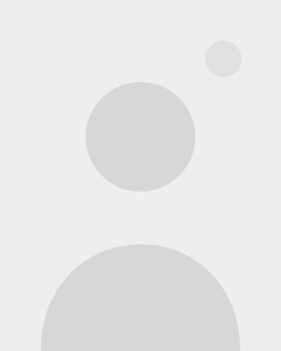

Bouwstenen: elk onderdeel van het sjabloon op één pagina, met de markdown erbij.
In de voorbeeldcode staat &#91; in plaats van [ aan het begin van een regel: anders leest
script.js die regel als een echte markering (ook binnen [html]).

[site]
titel: Bouwstenen · Studio Lumen
beschrijving: Alle onderdelen van het website-sjabloon op één pagina.

[rij verhouding=3:2]
[sectie]
[label Bouwstenen]
# Alles wat dit sjabloon ==kan==
Op deze pagina staat elk onderdeel van het sjabloon, met de tekst die je ervoor typt. Alles wordt geschreven in gewone tekstbestanden; er is geen bouwstap en geen beheersysteem nodig.

Zie je iets wat je mooi vindt? Tik op **Mooi** rechtsboven in de sectie. Het komt in je samenvatting op de pagina [Kies je stijl](stijl.html).

[Naar de thema's](#themas){.knop}
[Kies je stijl](stijl.html){.knop}

[sectie thema=primair patroon=images/cirkels.svg uitlijning=midden]
### In het kort
- Tekst in gewone **markdown**-bestanden
- Zes thema's en veertien patronen
- Rijen met één of twee secties
- Kaarten, tijdlijnen, citaten en knoppen
- Eigen HTML en scripts waar dat nodig is
- Opslaan in GitHub is publiceren

[rij]
[sectie thema=zacht]
[label Opbouw]
## Rijen en secties
Een pagina bestaat uit **rijen**. Een rij heeft één of twee **secties**, die naast elkaar staan op een computer en onder elkaar op een telefoon. Elke sectie krijgt een thema, en eventueel een patroon.

[html]

<pre class="broncode">&#91;rij verhouding=2:1]
&#91;sectie thema=primair patroon=images/stippen.svg]
&#91;label Aanbod]
## Waar ik je mee help
Gewone tekst, met **vet**, *cursief* en ==accent==.

&#91;sectie thema=zacht uitlijning=midden]
> Een citaat in de rechter sectie.</pre>
[/html]

[rij]
[sectie thema=licht id=themas]
[label Thema licht]
### Koppen in de kopkleur
Lopende tekst met een ==accentwoord== en een [link](#themas). Elk thema vult vijf rollen: achtergrond, tekst, koppen, accent en knoptekst.
- Opsommingsteken in de accentkleur
- Nog een punt

[Eerste knop](#themas){.knop}
[Tweede knop](#themas){.knop}

[sectie thema=zacht]
[label Thema zacht]
### Een getinte achtergrond
Lopende tekst met een ==accentwoord== en een [link](#themas). Handig om secties van elkaar te scheiden zonder harde kleur.
- Opsommingsteken in de accentkleur
- Nog een punt

[Eerste knop](#themas){.knop}
[Tweede knop](#themas){.knop}

[rij verhouding=2:1]
[sectie thema=primair]
[label Thema primair]
### De hoofdkleur van het merk
Lopende tekst met een ==accentwoord== en een [link](#themas). Deze rij staat in de verhouding **2:1**.
- Opsommingsteken in de accentkleur
- Nog een punt

[Eerste knop](#themas){.knop}
[Tweede knop](#themas){.knop}

[sectie thema=secundair]
[label Thema secundair]
### Een tweede kleur
Lopende tekst met een ==accentwoord==.

[Knop](#themas){.knop}

[rij verhouding=1:2]
[sectie thema=accent]
[label Thema accent]
### Opvallen
Lopende tekst met een ==accentwoord==. Deze rij staat in de verhouding **1:2**.

[Knop](#themas){.knop}

[sectie thema=donker]
[label Thema donker]
### Donker en rustig
Lopende tekst met een ==accentwoord== en een [link](#themas). Mooi voor een contactblok of een footer.
- Opsommingsteken in de accentkleur
- Nog een punt

[Eerste knop](#themas){.knop}
[Tweede knop](#themas){.knop}

[rij]
[sectie thema=primair koppen=accent accent=licht knoptekst=primair]
[label Eén rol anders]
### Koppen in de accentkleur
Een thema is een startpunt. Met *koppen=*, *accent=*, *tekst=*, *achtergrond=* of *knoptekst=* verander je één rol, zonder een nieuw thema te maken.

[Lichte knop](#themas){.knop}

[sectie thema=donker achtergrond=secundair]
[html]
<pre class="broncode">&#91;sectie thema=primair koppen=accent accent=licht knoptekst=primair]

&#91;sectie thema=donker achtergrond=secundair]</pre>
[/html]

Deze sectie is het thema *donker*, maar met de achtergrond van *secundair*.

[rij]
[sectie]
[label Kleuren]
## Zes kleuren, één palet
In *site.md* staan zes kleuren. Ze heten naar hun **rol**, niet naar hun tint. Daardoor kun je het hele palet in één keer vervangen, en blijven alle thema's kloppen. Precies dat doet de [stijlkiezer](stijl.html).

[sectie]
[html]
<pre class="broncode">&#91;kleuren]
licht: #F6F4EF
zacht: #E3ECEC
donker: #14232B
primair: #1F4E5F
secundair: #2F5D5C
accent: #E9A84C

&#91;thema primair]
achtergrond: primair
tekst: licht
koppen: licht
accent: accent
knoptekst: donker</pre>
[/html]

[rij verhouding=1:3]
[sectie thema=zacht]
[label Verhouding]
## 1 : 3
Smal en breed.

[sectie]
[label Ook mogelijk]
## Elke verhouding
Twee getallen met een dubbele punt: *verhouding=1:3*, *3:2*, *5:4*. Zonder verhouding zijn beide secties even breed. Een rij met één sectie gebruikt de hele breedte, zoals de rij hieronder.

[rij]
[sectie thema=primair patroon=images/topografie.svg]
[label Patronen]
## Veertien patronen
Een patroon neemt vanzelf de kleur van de achtergrond aan, net iets lichter of donkerder. Met *schaal=* maak je het groter of kleiner, met *sterkte=* duidelijker, en met *patroonkleur=* kies je zelf een kleur. Hieronder staan ze allemaal.

[rij]
[sectie patroon=images/stippen.svg sterkte=2]
[label Stippen]
*patroon=images/stippen.svg sterkte=2*

[sectie thema=zacht patroon=images/raster.svg sterkte=2]
[label Raster]
*thema=zacht patroon=images/raster.svg sterkte=2*

[rij]
[sectie thema=primair patroon=images/lijnen.svg schaal=1.5]
[label Lijnen]
*thema=primair patroon=images/lijnen.svg schaal=1.5*

[sectie thema=secundair patroon=images/plus.svg]
[label Plusjes]
*thema=secundair patroon=images/plus.svg*

[rij]
[sectie thema=accent patroon=images/ruit.svg sterkte=1.5]
[label Ruiten]
*thema=accent patroon=images/ruit.svg sterkte=1.5*

[sectie thema=donker patroon=images/zigzag.svg schaal=2]
[label Zigzag]
*thema=donker patroon=images/zigzag.svg schaal=2*

[rij]
[sectie thema=zacht patroon=images/schubben.svg sterkte=2]
[label Schubben]
*thema=zacht patroon=images/schubben.svg sterkte=2*

[sectie patroon=images/cirkels.svg patroonkleur=accent]
[label Cirkels]
*patroon=images/cirkels.svg patroonkleur=accent*

[rij]
[sectie thema=primair patroon=images/water.svg patroonkleur=licht schaal=1.5]
[label Water]
*thema=primair patroon=images/water.svg patroonkleur=licht schaal=1.5*

[sectie thema=accent patroon=images/zon.svg patroonkleur=licht]
[label Zonnetjes]
*thema=accent patroon=images/zon.svg patroonkleur=licht*

[rij]
[sectie thema=secundair patroon=images/blad.svg patroonkleur=accent]
[label Blaadjes]
*thema=secundair patroon=images/blad.svg patroonkleur=accent*

[sectie patroon=images/kiezels.svg sterkte=4 schaal=1.5]
[label Kiezels]
*patroon=images/kiezels.svg sterkte=4 schaal=1.5*

[rij]
[sectie thema=donker patroon=images/terrazzo.svg patroonkleur=secundair]
[label Terrazzo]
*thema=donker patroon=images/terrazzo.svg patroonkleur=secundair*

[sectie thema=zacht patroon=images/topografie.svg sterkte=2]
[label Hoogtelijnen]
*thema=zacht patroon=images/topografie.svg sterkte=2*

[rij]
[sectie thema=secundair patroon=images/schubben.svg schaal=2]
[label Naadloos]
### Eén patroon over twee secties
Staat hetzelfde patroon in beide secties van een rij, dan loopt het zonder naad door. Kijk maar naar het midden.

[sectie thema=secundair patroon=images/schubben.svg schaal=2 uitlijning=onder]
Ook als de secties verschillend breed zijn of de tekst anders is uitgelijnd.

[rij]
[sectie thema=primair patroon=images/plus.svg beweging=drijven tempo=20]
[label Beweging: drijven]
### Het patroon schuift langzaam op
*beweging=drijven tempo=20*: één tegel opschuiven in twintig seconden. Alleen op een computer met muis, en niet voor wie minder beweging heeft ingesteld.

[sectie thema=donker patroon=images/zon.svg patroonkleur=accent beweging=pulseren tempo=4]
[label Beweging: pulseren]
### Het patroon ademt
*beweging=pulseren tempo=4*: in vier seconden verschijnen en weer vervagen. Gebruik beweging spaarzaam: één bewegende sectie per pagina is genoeg.

[rij]
[sectie]
[label Uitlijning]
## Boven, midden of onder
Is de ene sectie hoger dan de andere, dan bepaal je met *uitlijning=* waar de tekst in de kortere sectie staat. Hier rechts: in het midden.

Deze linker sectie heeft daarom wat meer tekst. Een rij is altijd zo hoog als de hoogste sectie; de achtergrondkleuren lopen door tot de rand van het scherm, en tussen de secties zie je geen naadje.

Op een telefoon staan de secties gewoon onder elkaar en doet uitlijning niets.

[sectie thema=accent uitlijning=midden]
### uitlijning=midden
Netjes in het midden.

[rij verhouding=1:2]
[sectie thema=zacht]
[label Plakken]
## Deze tekst blijft staan
Bij twee secties naast elkaar blijft de kortste staan terwijl je scrolt, zolang hij op het scherm past. Scroll maar door de tijdlijn hiernaast.

[Naar de typografie](#typografie){.knop}

[sectie]
[tijdlijn 2014]
### Begonnen
Een tijdlijn-item begint met *[tijdlijn …]*. De tekst tussen de haken komt er klein boven te staan.
[tijdlijn 2017]
### Eerste medewerker
Opeenvolgende items vormen samen één tijdlijn, met een lijn van stip tot stip.
[tijdlijn 2020]
### Verhuisd
Een item mag alles bevatten: koppen, lijsten, knoppen, afbeeldingen.
- Bijvoorbeeld een lijst
- Met twee punten
[tijdlijn 2023]
### Nieuwe opleiding
Elk item vaagt los in zodra het in beeld komt.
[tijdlijn 2026 · nu]
### Vandaag
Een item loopt door tot de volgende markering.

[rij]
[sectie id=typografie]
[label Typografie]
# Kop 1
## Kop 2
De eerste alinea na een kop 1 of 2 is iets groter en zachter van kleur: een inleiding.

### Kop 3
#### Kop 4
Gewone tekst met **vet**, *cursief*, ==accent== en een [link naar boven](#themas).\
Een *\* aan het eind van een regel geeft een nieuwe regel, geen nieuwe alinea.

[sectie]
- Een opsomming
- met ronde punten
- in de accentkleur

1. Een genummerde lijst
2. werkt ook
3. vanzelf

> Een citaat staat in het kopfont, met een streep in de accentkleur.

[rij]
[sectie thema=zacht]
[label Knoppen naast elkaar]
### Naast elkaar
Knoppen op opeenvolgende regels staan naast elkaar. De eerste is opvallend, de rest rustig.

[Hoofdknop](#typografie){.knop}
[Tweede knop](#typografie){.knop}
[Derde knop](#typografie){.knop}

[html]
<pre class="broncode">&#91;Hoofdknop](#){.knop}
&#91;Tweede knop](#){.knop}
&#91;Derde knop](#){.knop}</pre>
[/html]

[sectie thema=zacht]
[label Knoppen onder elkaar]
### Onder elkaar
Met een lege regel ertussen staan ze onder elkaar, elk in de accentkleur.

[Eerste keuze](#typografie){.knop}

[Tweede keuze](#typografie){.knop}

[html]
<pre class="broncode">&#91;Eerste keuze](#){.knop}

&#91;Tweede keuze](#){.knop}</pre>
[/html]

[rij]
[sectie]
[label Kaarten]
## Tegels in een raster
Kaarten zonder lege regel ertussen staan naast elkaar. Een lege regel begint een nieuwe rij kaarten. Op een telefoon staan ze altijd onder elkaar.

[kaart]
### Eén
Drie kaarten naast elkaar.
[kaart]
### Twee
Met een kop en wat tekst.
[kaart]
### Drie
Of een lijst:
- punt
- punt

[kaart]
### Vier
Twee kaarten naast elkaar.
[kaart]
### Vijf
[Met een knop](#typografie){.knop}

[kaart]
### Zes: de hele breedte
[html]
<pre class="broncode">&#91;kaart]
### Vier
&#91;kaart]
### Vijf

&#91;kaart]
### Zes: de hele breedte</pre>
[/html]

[rij verhouding=2:3]
[sectie]

[sectie uitlijning=midden]
[label Afbeeldingen]
## Foto's en illustraties
Een uitroepteken, de omschrijving tussen vierkante haken en het pad tussen ronde haken zet een afbeelding in een sectie. De hoeken volgen de instelling voor rondheid; zet in de stijlkiezer de hoeken op *Recht* of *Heel rond* en kijk wat er gebeurt.

De omschrijving lezen schermlezers voor, en Google gebruikt hem ook.

[rij]
[sectie thema=donker]
[label Eigen HTML]
## Alles wat markdown niet kan
Tussen *[html]* en *[/html]* staat gewone HTML, inclusief scripts. Daarmee sluit je een agenda, formulier, kaart of video van een andere website in, of bouw je zelf iets kleins, zoals deze rekenhulp en deze uitklapvragen.

De tekeningen op de homepagina zijn ook HTML: ze gebruiken de kleuren van het palet, dus ze kleuren mee als je een ander palet kiest.

[sectie thema=donker]
[html]

  <h3>Wat kost een traject?</h3>
  <label for="sessies">Aantal sessies: <b id="aantal">6</b></label>
  <input id="sessies" type="range" min="1" max="12" value="6">
  <output id="prijs" for="sessies">€ 545</output>
  
Intake van € 75, daarna € 78 per sessie.

  

Werken scripts op elke pagina?

Ja. Een script in een [html]-blok wordt uitgevoerd zodra de pagina is opgebouwd.

  

Kan ik een agenda insluiten?

Ja. Plak de code van je agendaleverancier tussen de twee markeringen.

[/html]

[rij]
[sectie thema=accent]
[label Foutmeldingen]
## Een typfout zie je meteen
Staat er iets in een *.md*-bestand dat niet klopt, zoals een kleur die niet bestaat of een vergeten *[rij]*, dan verschijnt er bovenaan de pagina een rode balk die precies zegt wat er mis is. Zo:

[html]

Thema "paars" bestaat niet; maak een [thema paars] in site.md

[/html]

[rij]
[sectie thema=primair patroon=images/ruit.svg]
[label Ook ingebouwd]
## En verder
[kaart]
### Menu en footer
Eén keer in *site.md*, op elke pagina. Op een telefoon klapt het menu in achter een knop.
[kaart]
### Per pagina afwijken
Een pagina kan eigen kleuren, titel, menu of footer hebben. Kijk maar naar het menu op de [voorwaarden](voorwaarden.html).
[kaart]
### Ankers
Elke kop en elk label krijgt vanzelf een anker om naar te linken, zoals *#typografie*.

[kaart]
### Invagen
Blokken vagen één voor één in als ze in beeld komen.
[kaart]
### Printen
Een pagina printt zoals hij op het scherm staat, met kleuren.
[kaart]
### Snel
Geen bouwstap, geen database. Gratis te hosten op GitHub Pages.
